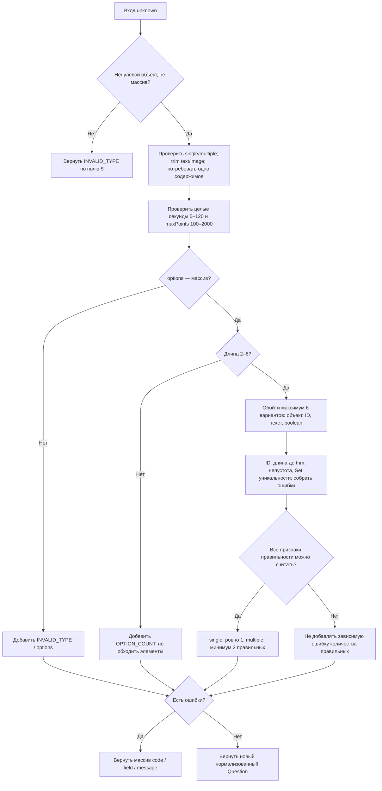
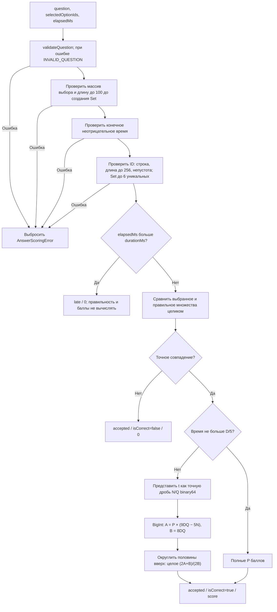
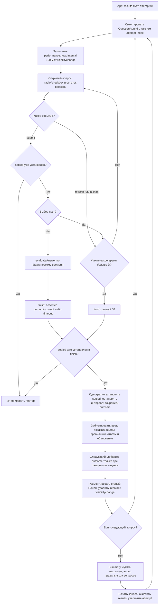

# Алгоритмы по фактическому коду

Снимок: HEAD 4ad431b, сверено 08.11.2026. Диаграммы описывают только локальный код; серверные состояния, БД и сеть в них не добавлены.

## 1. Валидация вопроса

Источник: [question-validation.ts](../../../../packages/shared/src/question-validation.ts), строки 59–248. Вход unknown, результат success/data либо success=false/errors. Ошибки собираются в порядке проверок. Нормализация создаёт новые объекты; исходный вход не изменяется. ID ограничен 256 кодовыми единицами UTF-16 до trim; уникальность проверяется после trim, регистр значим. Отсутствующие числовые настройки не подставляются автоматически.

Неверный тип вопроса уже добавляет ошибку; проверка количества правильных применима только для известного single/multiple. Непустой image означает только наличие строки, а не безопасность файла. Произвольные getter/Proxy не изолируются.

## 2. Проверка ответа и баллы

Источник: [answer-scoring.ts](../../../../packages/shared/src/answer-scoring.ts). checkAnswer (172–180) валидирует вопрос/выбор и сравнивает множества без времени. calculateScore (183–217) проверяет maxPoints, durationMs, elapsedMs и считает только правильный ответ. Общая evaluateAnswer (220–240) использует следующий порядок.

Любая ошибка аргумента на обязательном этапе означает AnswerScoringError, а не обычный неправильный ответ. Поздний ответ также проходит ограниченную валидацию ID: просрочка не скрывает неверные аргументы. Дубликаты не увеличивают число выбранных вариантов; порядок multiple не влияет; неизвестный непустой ID в пределах лимитов даёт неправильный ответ.

После бесплатных 20% исходная формула эквивалентна P×(9D−5t)/(8D). Для целого t используется BigInt; для дробного — точное двоичное значение переданного number, не исходная десятичная строка. Окончательный балл не больше 2000, поэтому обратно в number он переводится без потерь. Epsilon не используется. Равенство t=D допустимо; дробное конечное время допустимо. Длительность соответствует 5–120 целым секундам, переданным в миллисекундах.

## 3. Состояния локального демонстрационного квиза

Источник: [App.tsx](../../../../apps/web/src/App.tsx), строки 18–89 и 276–327. Это не серверный автомат игровой комнаты.

Время не уменьшается на единицу за tick: остаток каждый раз вычисляется из разницы performance.now. При t=D отображается 0 секунд, но форма ещё принимает ответ; при отправке время проверяется заново. settled устанавливается синхронно через ref до React-render, что исключает перезапись принятого результата поздним callback. При произвольном внешнем размонтировании cleanup также выполняется. Состояние не сохраняется после обновления страницы. Правильные ответы технически входят в клиентский bundle только для демо.
