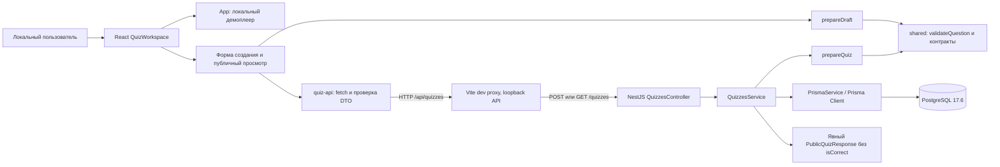
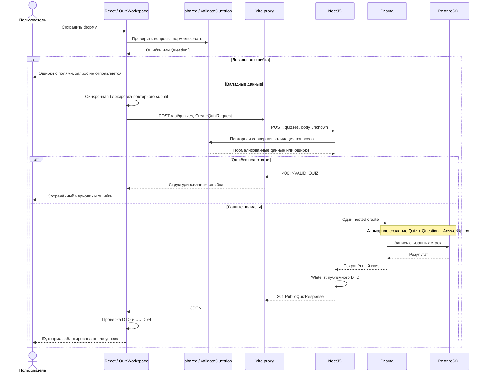
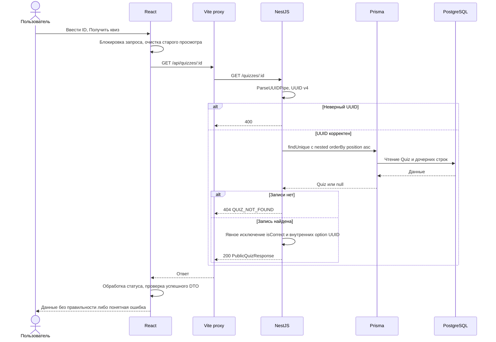
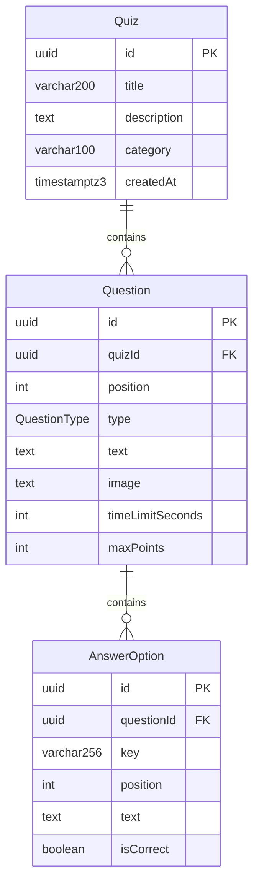

# Архитектура интеграции ПМ02

Срез кода: main, 67a11ad; подготовлено 20.11.2026. Источники: [ТЗ](../../../requirements/TECHNICAL_SPEC_v1.0.md), [№ 005](../../../tasks/005-api-database-integration.md), [№ 006](../../../tasks/006-frontend-api-integration.md), [схема Prisma](../../../../apps/api/prisma/schema.prisma), [миграция](../../../../apps/api/prisma/migrations/202611170001_init_quizzes/migration.sql). Диаграммы показывают реализованный локальный сценарий, а не весь запланированный MVP.

## 1. Компоненты

Ответы проходят обратно через controller и proxy в fetch-клиент. Ветвь демоплеера не получает сохранённый квиз для оценивания. PrismaService подключается при инициализации включённого модуля и отключается при закрытии. ENABLE_QUIZ_API=false оставляет только /health; API слушает 127.0.0.1. Vite — локальный dev-proxy, а не production gateway. Источники: [main API](../../../../apps/api/src/main.ts), [AppModule](../../../../apps/api/src/app.module.ts), [PrismaService](../../../../apps/api/src/database/prisma.service.ts), [Vite](../../../../apps/web/vite.config.ts), [корень frontend](../../../../apps/web/src/main.tsx).

## 2. Создание квиза

Повреждённый успешный ответ и сетевой сбой не подтверждают отсутствие записи. Клиент показывает предупреждение и не повторяет POST автоматически. Это не серверная идемпотентность. Источники: [форма](../../../../apps/web/src/QuizWorkspace.tsx), [клиент](../../../../apps/web/src/quiz-api.ts), [подготовка](../../../../apps/api/src/quizzes/prepare-quiz.ts), [сервис](../../../../apps/api/src/quizzes/quizzes.service.ts).

## 3. Получение квиза

Источник: [контроллер](../../../../apps/api/src/quizzes/quizzes.controller.ts), [сервис](../../../../apps/api/src/quizzes/quizzes.service.ts), [клиент](../../../../apps/web/src/quiz-api.ts). При ошибке БД сервис возвращает безопасный 503. /health — liveness, не самостоятельное доказательство доступности БД.

## 4. ER-диаграмма

По [schema.prisma](../../../../apps/api/prisma/schema.prisma): image nullable; QuestionType = single/multiple; UUID создаёт Prisma. Question уникален по (quizId, position); AnswerOption — по (questionId, key) и (questionId, position). FK каскадно удаляют дочерние строки. key соответствует доменному ID варианта, id — внутренний UUID строки. Граф показывает 0..n на уровне БД; API дополнительно требует хотя бы один вопрос и 2–6 вариантов. CHECK миграции проверяют локальные диапазоны/содержимое, но не межстрочное число правильных вариантов. Полный CRUD, владельцы, игровые снимки, комнаты и авторизация в эту схему не входят.
