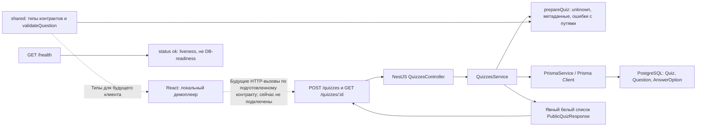
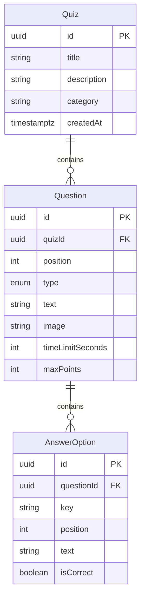

# Задача № 005 — подготовка интеграции API и PostgreSQL

Дата выполнения: 17.11.2026 (Europe/Moscow). ПМ02, этап 09.11–22.11.2026. Исходное состояние: ветка main, HEAD caa0b86, рабочее дерево чистое. До задачи API содержал только GET /health; Prisma, таблицы и маршруты квизов отсутствовали. ПМ01 и демонстрационный плеер не перерабатывались.

## Контракты

Источник — packages/shared/src/quiz-contracts.ts, экспорт через публичный index shared. Доменные Question и AnswerOption переиспользованы без изменения validateQuestion.

- CreateQuizRequest: title, необязательные description/category, непустой массив questions: Question[]. Это авторский вход: isCorrect необходим для сохранения ключа, но не является данными участника.
- PublicQuestion: явный Pick только type/text/image/timeLimitSeconds/maxPoints, отдельный UUID вопроса и варианты Pick<AnswerOption, id/text>. Секретные поля не наследуются через общий Omit или spread.
- PublicQuizResponse: UUID, название, описание, категория, createdAt как ISO UTC и упорядоченные PublicQuestion[]. Признаки правильности, внутренние option UUID и дополнительные поля Prisma не возвращаются.
- QuizValidationErrorResponse: code=INVALID_QUIZ, errors с code/field/message. Ошибки shared получают префикс questions[i], включая вложенные варианты. INVALID_VALUE означает строку, непредставимую в PostgreSQL UTF-8 (NUL/изолированный суррогат).

| HTTP                                   | Вход                                | Ответ                                               |
| -------------------------------------- | ----------------------------------- | --------------------------------------------------- |
| POST /quizzes                          | CreateQuizRequest, runtime unknown  | 201 PublicQuizResponse                              |
| GET /quizzes/:id                       | UUID v4                             | 200 PublicQuizResponse, 404 QUIZ_NOT_FOUND          |
| Неверное тело                          | Обязательные поля, строки и вопросы | 400 INVALID_QUIZ с путями полей                     |
| Неверный UUID / JSON / чрезмерное тело | Транспортная проверка Nest/Express  | 400 / 413, стандартный формат Nest                  |
| Недоступность БД при запросе           | Ошибка Prisma                       | 503 DATABASE_UNAVAILABLE без URL и деталей драйвера |

Название — непустая строка до 200 кодовых единиц UTF-16, description до 2000, category до 100. Метаданные trim; отсутствующие description/category сохраняются пустыми строками. Неизвестные поля не копируются. Вопросы проверяются существующим validateQuestion; image — только строковый ключ/ссылка, загрузка и безопасность файла не реализованы. Проверяются исходные типы, строковые числа не приводятся. Строки с NUL или некорректным Unicode отклоняются до Prisma. HTTP JSON ограничен 100 KiB; подготовка данных вызывается после этого транспортного лимита. Ошибки метаданных проверяются до прохода вопросов; для первого невалидного вопроса возвращаются все его ошибки. Это API создания валидного квиза, не сохранение неполного черновика.

Frontend в этой задаче получает типизированный контракт через уже имеющуюся workspace-зависимость shared. Сетевые вызовы и редактор в текущем плеере не добавлены; он по-прежнему локальный. Пример будущего авторского клиента: формировать CreateQuizRequest, отправлять JSON POST /quizzes и получать только PublicQuizResponse. Типизация не заменяет серверную проверку unknown.

## Архитектура и включение



Маршруты квизов выключены по умолчанию. AppModule.configure(false) оставляет только /health; main включает QuizzesModule только при ENABLE_QUIZ_API=true. API слушает исключительно 127.0.0.1, PORT по умолчанию 3000. Пока нет авторизации и владельцев, это локальный интеграционный API, не публичный сервис управления чужими квизами. CORS и browser-network-клиент не добавлены.

PrismaService получает DATABASE_URL из окружения, проверяет PostgreSQL URL, подключается на OnModuleInit и отключается при закрытии приложения. Безопасные сообщения не выводят пароль или URL. При включённой интеграции отсутствие конфигурации/соединения останавливает запуск; при выключенной DB не требуется. /health остаётся liveness, а не доказательством доступности БД после старта.

## Prisma и схема

Зафиксированы prisma и @prisma/client 6.19.0: классический prisma-client-js совместим с CommonJS API. Node 24 поддерживается выбранной линией; версия не заявляется последней. Генерация явная через prepare:api, который также собирает shared, поэтому прямые API-команды работают на чистом checkout. В trusted build scripts pnpm добавлены только необходимые Prisma-пакеты. Генерируемый клиент находится в игнорируемом node_modules.

Источники решения: [системные требования Prisma v6](https://www.prisma.io/docs/orm/v6/reference/system-requirements), [генераторы клиента](https://www.prisma.io/docs/orm/v6/prisma-schema/overview/generators). Переход на другую major-версию — отдельное техническое решение.



UUID создаются Prisma. key — существующий доменный AnswerOption.id, уникальный внутри вопроса; отдельный UUID строки не раскрывается как идентификатор варианта. Позиции уникальны внутри родителя и неотрицательны. Retrieval сортирует и вопросы, и варианты по position. Quiz.createdAt хранится TIMESTAMPTZ(3). Foreign keys удаляют дочерние записи каскадно; API удаления здесь отсутствует.

Миграция 202611170001_init_quizzes содержит enum, таблицы, foreign keys, уникальные индексы и row-local CHECK: непустые title/key/option text, содержимое question text либо image, секунды 5–120, баллы 100–2000, длина description. Составные индексы начинаются с родительского FK и обслуживают ordered retrieval. CHECK на btrim и PostgreSQL VARCHAR не эквивалентны всем Unicode/UTF-16 правилам JS: строгая проверка выполняется API. Межстрочные условия (2–6 вариантов, количество правильных, хотя бы один вопрос) не имитируются SQL CHECK, их обеспечивает validateQuestion/prepareQuiz. Прямой SQL в обход приложения не получает этих гарантий.

Сохранение использует один nested create Prisma, атомарный для Quiz/Question/AnswerOption. Сначала проверяется весь вход, затем выполняется запись. Ошибка вложенной записи откатывает создание. Схема минимальна: нет User/owner, AuthSession, игровых комнат, снимков и истории. Перед авторизацией и игровыми сессиями потребуются отдельные миграции и решения о владельце/снимках; QUIZ-08 целиком здесь не реализован.

## Окружение и команды

.env.example содержит только шаблоны. Существующий .env не менялся. Для локальной работы в нём нужны согласованные POSTGRES_PASSWORD и DATABASE_URL; специальные символы пароля в URL кодируются. Миграции не выполняются автоматически при старте API и не вызывают reset.

```sh
pnpm install --frozen-lockfile
# После настройки .env и запуска существующего Compose PostgreSQL:
pnpm --filter @quiz/api db:validate
pnpm --filter @quiz/api db:migrate
ENABLE_QUIZ_API=true pnpm --filter @quiz/api dev
```

Стандартные pnpm test используют unit/HTTP mock-тесты и не требуют PostgreSQL. Реальный набор запускается отдельно:

```sh
# TEST_DATABASE_URL задаётся безопасно через окружение и указывает на отдельную *_test БД.
pnpm --filter @quiz/api test:integration
```

Этот набор делает записи. Guard требует явного TEST_DATABASE_URL с именем БД, заканчивающимся на \_test; тест удаляет только созданные им успешные записи, без reset/truncate. Миграция должна быть применена заранее. Дополнительная защита — выделенная одноразовая БД; суффикс не заменяет изоляцию и проверку оператора. CI дополнен PostgreSQL service и явными validate/migrate/integration шагами. Статические credentials workflow предназначены только для изолированной CI-БД, не являются секретами реальной среды; новый удалённый CI в этой сессии не запускался.

## Фактическое тестирование

17.11.2026 Docker Engine доступен, существующий compose postgres healthy. Для записи и миграции запущен отдельный postgres:17.6-alpine со случайным паролем в окружении процесса и случайным loopback-портом, без существующего volume. Применена миграция, migrate status показал актуальную схему, повторный deploy — отсутствие pending migrations. Четыре реальных теста проверили HTTP roundtrip, порядок и отсутствие isCorrect, отсутствие частичной записи, SQL unique и диапазоны с rollback. Собранный API отдельно запущен процессом Node: /health 200, POST 201, GET 200 с одинаковым безопасным DTO. PostgreSQL сообщил версию 17.6; в истории миграций одна успешная запись. Контейнер и API остановлены после проверки.

Итоговый прогон 17.11.2026: install --frozen-lockfile, lint, typecheck, test, build, format:check и git diff --check — код 0. Успешны 340 обычных тестов (277 shared, 30 web, 33 API), отдельно 4 DB-теста. Проверяются нормализация без мутации, неверные типы/пределы/Unicode, ошибки shared с путями, whitelist, порядок, HTTP 400/404/413/503 и выключенные маршруты. После ошибки no-control-regex проверка NUL заменена эквивалентной includes(String.fromCharCode(0)); полный прогон повторён. Команды и результаты сохранены в [005-checks.txt](../practice/PM02/evidence/005-checks.txt). Подробности и ограничения — [свидетельство](../practice/PM02/evidence/005-integration.md), журнал — [ПМ02](../practice/PM02/progress.md). Ранние ошибки среды: frozen install на этапе изменения manifests, DNS ENOTFOUND, запрет обновления Prisma cache EPERM; после обновления lockfile/разрешённых повторов проверки выполняются заново. Форматирование .env.example отдельным Prettier-парсером не поддерживается; итоговый format:check проверяет поддерживаемые файлы.

## Границы и следующий этап

Нет авторизации, UI-редактора, Socket.IO, комнат, синхронизации, настоящего игрового таймера, снимков, результатов/истории, файлового хранилища или деплоя. Правильные ответы остаются в БД и авторском входе; публичный DTO не отдаёт их даже в POST-response. В демоплеере ПМ01 они по-прежнему локальные, как документировано ранее — это отдельный режим, не подключённый к API.

Следующая рекомендуемая интеграционная задача — согласовать и реализовать сессии/авторизацию и принадлежность квиза, затем защищённое авторское чтение. До этого не открывать локальные authoring-маршруты наружу. Коммиты, push и публикация не выполнялись.

## Перечень изменённых и созданных файлов

- `.env.example`
- `.github/workflows/ci.yml`
- `README.md`
- `apps/api/package.json`
- `apps/api/src/app.module.ts`
- `apps/api/src/main.ts`
- `apps/api/test/health.test.ts`
- `packages/shared/src/index.ts`
- `pnpm-lock.yaml`
- `pnpm-workspace.yaml`
- `apps/api/prisma/migrations/202611170001_init_quizzes/migration.sql`
- `apps/api/prisma/migrations/migration_lock.toml`
- `apps/api/prisma/schema.prisma`
- `apps/api/src/database/prisma.service.ts`
- `apps/api/src/quizzes/prepare-quiz.ts`
- `apps/api/src/quizzes/quizzes.controller.ts`
- `apps/api/src/quizzes/quizzes.module.ts`
- `apps/api/src/quizzes/quizzes.service.ts`
- `apps/api/test/database-config.test.ts`
- `apps/api/test/database.integration.test.ts`
- `apps/api/test/prepare-quiz.test.ts`
- `apps/api/test/quiz.fixture.ts`
- `apps/api/test/quizzes-http.test.ts`
- `docs/practice/PM02/evidence/005-checks.txt`
- `docs/practice/PM02/evidence/005-integration.md`
- `docs/practice/PM02/progress.md`
- `docs/tasks/005-api-database-integration.md`
- `packages/shared/src/quiz-contracts.ts`
