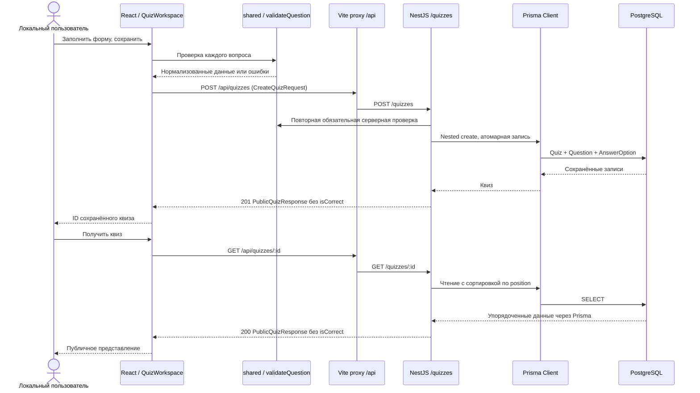

# Задача № 006 — сквозная интеграция frontend, API и PostgreSQL

ПМ02, фактическая дата выполнения: 17.11.2026 (Europe/Moscow). Исходное состояние: main, HEAD 19833edc19feaeb1b247642ef11d09cd5da4ff44, чистое дерево. Пользователь сообщил об успешном CI #8 для № 005; удалённый CI в этой сессии непосредственно не проверялся. Изучены ТЗ, задачи № 001–005 и действующие контракты.

## Постановка и реализация

Минимальный локальный сценарий: составить валидный квиз → POST → сохранить ID → отдельно GET → показать публичные данные. Существующие App, демоданные, таймер и формула баллов не изменены. Новый корневой QuizWorkspace переключает демоплеер и редактор; по умолчанию открыт прежний деморежим. API, Prisma, миграция и публичные shared-контракты задачи № 005 не менялись.

- quiz-draft.ts хранит отдельную модель формы: стабильный локальный key, строковые числовые поля для пустого ввода, доменные варианты с UUID. newQuestion использует исходные значения по умолчанию: 4 варианта, 30 секунд, 1000 баллов.
- prepareDraft использует validateQuestion для каждого вопроса, получает нормализованный Question и префиксует ошибки questions[i]. Пустые числа превращаются в NaN и отклоняются shared. Правила количества вариантов, правильности, времени и баллов не дублируются. Локальный key не попадает в запрос. Название/описание trim; название обязательно. Ограничения метаданных задаются полями формы, окончательная проверка остаётся на API.
- Редактор позволяет добавлять и удалять вопросы, перемещать их вверх/вниз, добавлять/удалять варианты в пределах 2–6. Порядок массива сохраняется; при удалении ID оставшихся вариантов не меняются. single использует radio, multiple — checkbox. При смене multiple на single остаётся первый отмеченный вариант; если его нет, ошибку покажет validateQuestion.
- quiz-api.ts отправляет типизированный CreateQuizRequest через fetch, различает структурированные ошибки API, HTTP-ошибки, сетевые сбои и несоответствие успешного ответа форме DTO. Ошибки драйвера/неизвестное тело сервера не копируются в интерфейс. Неуспех не запускает автоматический повтор.
- Синхронный ref-флаг блокирует параллельные запросы до обновления React state; fieldset и кнопки блокируются на время запроса. После успешного POST форма остаётся заблокированной до явного «Создать другой квиз». Отложенные ответы после размонтирования не меняют интерфейс.
- После POST выводится ID; публичное представление появляется только после отдельного GET. Можно ввести ID ранее сохранённого квиза. Перед новым GET старый результат удаляется, чтобы не показывать устаревший квиз рядом с новой ошибкой.
- Публичный article явно отображает только текст, тип, время, баллы, ID и тексты вариантов. Даже дополнительные поля в mock-ответе не рендерятся. GET не используется для игровой оценки.

## Взаимодействие компонентов



## Локальная конфигурация

Vite proxy удаляет префикс /api, целевой адрес всегда 127.0.0.1. QUIZ*API_PORT читается конфигурацией Vite из окружения процесса, целый порт 1–65535, по умолчанию 3000. Переменная не имеет префикса VITE* и не содержит PostgreSQL credentials. DATABASE_URL остаётся только в NestJS/Prisma. Авторизация/CORS не добавлялись; запросы браузера идут на свой origin через dev-proxy.

```sh
# После настройки .env, запуска compose и миграции из № 005:
ENABLE_QUIZ_API=true pnpm dev
# Если 3000 занят:
PORT=3001 QUIZ_API_PORT=3001 ENABLE_QUIZ_API=true pnpm dev
```

Первый сквозной запуск 17.11 остановился из-за занятого 3000. Чужой процесс не останавливался. Для независимой тестовой среды выбран свободный API-порт и согласованный QUIZ_API_PORT; это же решение документировано для разработчика.

## Доступность и адаптивность

Семантические form/fieldset/legend/label, нативные radio/checkbox/select, кнопки перемещения с различимыми aria-label, видимый focus. Ошибки имеют role=alert, получают фокус; сообщения — aria-live, публичный результат получает фокус. На узком экране колонки и числовые поля переходят в один столбец. Кнопки минимум 44 px, инпуты min-width:0, длинные тексты переносятся. Новые стили не добавляют анимаций; правила reduced-motion прежнего плеера сохранены.

## Проверки и доказательства

Добавлено 21 автоматическое frontend-испытание: 15 UI/API mock-сценариев и 6 проверок подготовки данных. Существующие 30 frontend-тестов сохранены. Проверяются нормализация без мутаций, обязательные поля, числовые границы через shared, multiple, порядок и удаление вопросов/вариантов, single, POST/GET, сеть, HTTP 400/404/413/503, лишние поля, некорректный DTO, повторная отправка, новый черновик и поздний ответ.

Реальный сквозной сценарий выполнен в Chrome через CDP, без установки браузерных зависимостей в проект: React → Vite → собранный NestJS → Prisma → отдельный postgres:17.6-alpine → GET → React. Проверены пять ширин, клавиатурный Tab, режим reduced-motion, один POST при двух submit-событиях. SQL подтвердил сохранённые данные. Подробности:

- [Свидетельство](../practice/PM02/evidence/006-integration.md).
- [Фактические команды и результаты](../practice/PM02/evidence/006-checks.txt).
- [Протокол сквозного тестирования](../testing/006-e2e-2026-11-17.md).
- [Листинги с проверенными диапазонами строк](../practice/PM02/evidence/006-code-excerpts.md).
- [Журнал ПМ02](../practice/PM02/progress.md).

Итоговый повторный прогон 17.11.2026: pnpm install --frozen-lockfile, lint, typecheck, test, build, format:check и git diff --check — все завершились с кодом 0. Обычный набор: 361 тест (277 shared + 51 web + 33 API), отдельно 4 DB-теста. Первоначальная ошибка format:check в QuizWorkspace.test.tsx исправлена; полный набор повторён. Сквозной браузерный сценарий выполнен дважды; скриншоты/JSON относятся к последнему прогону.

## Ограничения

Только локальный режим: API по-прежнему opt-in и loopback. Нет авторизации, комнат, Socket.IO, серверной игры, изменения сохранённого квиза, удаления из БД, загрузки изображений или production proxy. Изображение при чтении показано как текстовый ключ/ссылка, без запроса к произвольному URL. Категория в этой минимальной форме не редактируется. Черновик не сохраняется между перезагрузками/сменой режима. Правильные ответы доступны автору в его форме; публичный GET их не содержит. Демо по-прежнему содержит локальные ключи и не является серверной игрой.

Блокировка предотвращает дубли от быстрых нажатий в текущей форме, но не обеспечивает серверную идемпотентность при потере ответа, перезагрузке или отправке другим клиентом. При сетевом сбое факт сохранения может быть неизвестен, интерфейс предупреждает об этом. Нет автоматических повторов. Тестовая БД удалена после проверки; ID со скриншотов не доступен в обычной локальной БД. Полного аудита WCAG, screen reader и реальных мобильных устройств не проводилось. Новый GitHub Actions не запускался. Коммиты и push не выполнялись.

## Изменённые и созданные файлы

- `README.md`
- `apps/web/src/main.tsx`
- `apps/web/vite.config.ts`
- `docs/practice/PM02/progress.md`
- `apps/web/src/QuizWorkspace.test.tsx`
- `apps/web/src/QuizWorkspace.tsx`
- `apps/web/src/quiz-api.ts`
- `apps/web/src/quiz-draft.test.ts`
- `apps/web/src/quiz-draft.ts`
- `apps/web/src/workspace.css`
- `docs/practice/PM02/evidence/006-browser-results.json`
- `docs/practice/PM02/evidence/006-checks.txt`
- `docs/practice/PM02/evidence/006-code-excerpts.md`
- `docs/practice/PM02/evidence/006-editor-1280-2026-11-17.png`
- `docs/practice/PM02/evidence/006-editor-375-2026-11-17.png`
- `docs/practice/PM02/evidence/006-integration.md`
- `docs/practice/PM02/evidence/006-view-1280-2026-11-17.png`
- `docs/practice/PM02/evidence/006-view-375-2026-11-17.png`
- `docs/practice/PM02/evidence/006-view-768-2026-11-17.png`
- `docs/tasks/006-frontend-api-integration.md`
- `docs/testing/006-e2e-2026-11-17.md`

## Точечное исправление после аудита — 20.11.2026

Выполнено без изменения backend/shared, Prisma, зависимостей и состояния демоплеера. Клиент проверяет корневой ID успешного DTO по UUID v4 (тот же формат, что ParseUUIDPipe API), без trim или подмены идентификатора. Пустой, пробельный, отсутствующий ID, произвольная строка и UUID другой версии отклоняются до возврата createQuiz. Поэтому QuizWorkspace не устанавливает hasSaved и не попадает в противоречивое состояние.

Повреждённый успешный POST сообщает: сервер мог сохранить квиз, но подтвердить результат не удалось; создание нельзя повторять без проверки. Автоматических повторов нет. Черновик остаётся доступным. Возможна только явная пользовательская повторная отправка, риск дубля при неопределённом результате остаётся документированным ограничением.

Ошибка разбора JSON больше не отменяет обработку HTTP-статуса. Для 400/404/413/500/503 сохраняются смысл и безопасное сообщение при JSON, пустом и HTML-теле; сырой ответ не отображается. Только HTTP 400 с INVALID_QUIZ обрабатывается как достоверная валидация запроса. Для POST 500/503 добавляется предупреждение о неопределённом сохранении. Сеть, повреждённые успешные GET/POST и блокировки остаются под контролем клиента.

До исправления добавленные регрессии дали 39 ожидаемых падений и 58 успешных тестов. После исправления frontend: 97/97, включая 46 новых регрессий (42 клиента и 4 UI). Подробные итоговые проверки — [протокол исправления](../practice/PM02/evidence/006-error-handling-fix.md), [реальный лог](../practice/PM02/evidence/006-error-handling-checks.txt). Скриншоты и DB/browser-протокол 17.11 остаются историческими: повторного браузерного или DB-прогона 20.11 не заявляется.

Итог исправления 20.11.2026: frozen install, lint, typecheck, test, build, format:check и git diff --check — код 0; 407 тестов (277 shared + 97 frontend + 33 API). Повторные проверки БД/браузера в этот день не выполнялись.
