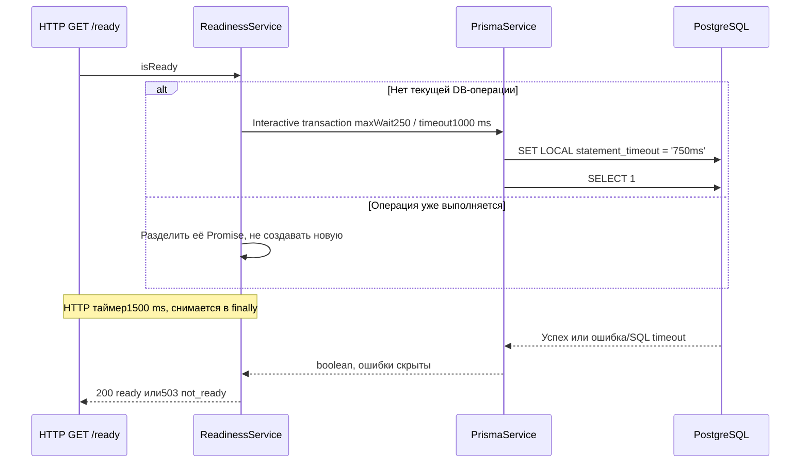

# № 008 — диагностика запуска и DB-readiness

Фактическая дата: 23.11.2026, Europe/Moscow. ПМ04, период 23.11–13.12.2026. Исходная ветка main, HEAD aaaa635. При начале работы уже присутствовали незакоммиченные документы/скрипт № 007; они сохраняются, progress дополняется новой записью. Новых commit/push нет, № 009 не начинается.

## Основание и минимальные изменения

[№ 007](007-maintenance-baseline.md) обнаружил ошибочный совет проверить БД при неверном PORT и отсутствие отдельного DB-readiness сигнала. Это модификация существующих компонентов, без новых игровых функций, auth, WebSocket, зависимостей, миграций и изменения shared/POST/GET контрактов.

- startup-config.ts: readPort принимает undefined как 3000; строку trim, проверяет десятичные цифры, целое число 1–65535. Пустые, нечисловые, дробные, NaN/Infinity и значения вне диапазона отклоняются. PortConfigurationError содержит постоянное сообщение без самого значения.
- main.ts использует readPort до создания Nest. Catch различает только безопасную ошибку PORT и прежнее общее сообщение запуска/БД. Enable-флаг, body limit, shutdown hooks и bind 127.0.0.1 сохранены.
- ReadinessController/Service добавлены в существующий opt-in QuizzesModule с тем же PrismaService, без отдельного DB-клиента или переустройства модулей. При ENABLE_QUIZ_API=false /ready отсутствует, /health работает по-прежнему.

## Контракты и границы

| Условие                                   | /health        | /ready                            |
| ----------------------------------------- | -------------- | --------------------------------- |
| DB-модуль выключен                        | 200, status=ok | 404                               |
| Включён, приложение запущено, БД отвечает | 200, status=ok | 200, status=ready                 |
| БД остановлена/зависла после старта       | 200, status=ok | 503, status=not_ready             |
| БД вернулась после отказа                 | 200, status=ok | 200 после новой успешной проверки |

При недоступной БД на **старте** прежний PrismaService.$connect останавливает запуск. Новый endpoint не меняет эту политику: до старта API он недоступен. SELECT 1 проверяет только возможность операции с БД, не наличие таблиц, всех миграций, ролей или состояние игры. HTTP-ошибки готовности не содержат SQL, URL, credentials или stack.

## Ограничение времени и ресурсов



SET LOCAL меняет только параметр текущей транзакции; таблицы не изменяются. SQL750, transaction1000 и maxWait250 ограничивают обычную DB-работу. HTTP1500 защищает клиента также от зависания сетевого старта операции. Это timer deadline, не hard real-time гарантия при блокировке Node event loop. Promise.race не объявляется SQL-cancel: после HTTP-таймаута underlying operation хранится до фактического завершения, новые probes используют её же. Ошибки, в том числе поздние, преобразуются в false; таймеры HTTP очищаются. На процесс не более одной фактической readiness-транзакции.

## Регрессии до/после

Тесты добавлены **до** изменения кода: pnpm --filter @quiz/api test дал 12 ожидаемых падений / 38 успешных, всего50. Девять PORT-случаев получали прежнее сообщение о БД, три /ready-теста — 404. Disabled-ready404 и прежний /health уже проходили. После реализации 50/50 обычных API-тестов успешны. Отдельный DB-тест /ready добавлен в существующий integration-набор.

Проверяются default/корректные PORT, пустые/пробельные и невалидные значения, PORT=abc с отключённым API; безопасные 200/503 ready; неизменность health; отсутствие SQL/credentials в ответе; общая зависшая операция, HTTP deadline, поздний reject и возможность новой успешной проверки. Unit/HTTP тесты используют mock Prisma, реальные DB-проверки выделены отдельно.

## Воспроизведение стенда и сравнение

```sh
nvm use
pnpm install --frozen-lockfile
pnpm lint
pnpm typecheck
pnpm test
pnpm build
pnpm format:check
python3 scripts/diagnostics/008-readiness.py --date 2026-11-23 --requests 50 --repeats 3
git diff --check
```

Скрипт — отдельный от № 007, старые результаты не перезаписывает. Создаёт собственную синтетическую quiz008_test, фиксированный свободный loopback port, лимиты PostgreSQL2 CPU/512 MiB. Выполняет миграцию, DB-тесты, запуск API/Vite, проверяет типовые ошибки, затем прогрев10 GET+10 POST и три повтора по50 для GET/POST при C1/C4. Таким образом **150 на сценарий суммарно**, как № 007, а не150 в каждом повторе. 600 измеряемых запросов. Payload752 bytes тот же. После измерений отдельно20 healthy ready, stop/start и pause/unpause только собственного контейнера. Вне сети интернет, без пользовательских volumes.

Методика nearest-rank p50/p95 и req/s по суммарному wall сохранена. Сравнение — с [итоговой серией007](../practice/PM04/evidence/007-results.json), не с первой неуспешной попыткой. Результаты после изменения и ограничения: [008-before-after.md](../practice/PM04/evidence/008-before-after.md), [008-security-reliability.md](../practice/PM04/evidence/008-security-reliability.md), [лог](../practice/PM04/evidence/008-checks.txt), [свидетельство](../practice/PM04/evidence/008-modification.md).

## Вопросы для независимого аудита

Проверить ограничение underlying-операций при зависшей сети; достаточность таймаутов для целевой среды; влияние частоты probes на общий Prisma pool; интерпретацию /ready только как DB-connectivity; поведение shutdown при долгом сетевом зависании. Нагрузочный тест с непрерывным readiness-трафиком и hard real-time гарантии здесь не заявляются. Никаких изменений startup $connect/health/quiz-контрактов или сетевой доступности не требовалось.

## Полный список файлов именно модификации № 008

Артефакты007 уже существовали при начале и в список ниже не включены.

- `README.md`
- `apps/api/src/main.ts`
- `apps/api/src/startup-config.ts`
- `apps/api/src/database/readiness.controller.ts`
- `apps/api/src/database/readiness.service.ts`
- `apps/api/src/quizzes/quizzes.module.ts`
- `apps/api/test/startup.test.ts`
- `apps/api/test/readiness.test.ts`
- `apps/api/test/database.integration.test.ts`
- `scripts/diagnostics/008-readiness.py`
- `docs/tasks/008-startup-readiness.md`
- `docs/practice/PM04/progress.md`
- `docs/practice/PM04/evidence/008-modification.md`
- `docs/practice/PM04/evidence/008-checks.txt`
- `docs/practice/PM04/evidence/008-before-after.md`
- `docs/practice/PM04/evidence/008-security-reliability.md`
- `docs/practice/PM04/evidence/008-results.json`

## Историческое дополнение: аудит и исправление № 008a, 23.11.2026

Исходные результаты, кодовые hashes и ограничения № 008 выше сохранены. Независимый аудит обнаружил рост удерживаемых Promise-reactions при длительном зависании и отсутствие общего bounded shutdown. Исправления и новые измерения относятся к [№ 008a](008a-readiness-shutdown-fixes.md), а не к исходному № 008. Старые008 JSON/log не являются hashes текущей исправленной реализации.
